<h1 align="center">Hey, I'm Alan 👋</h1>

  <b>Junior Software Developer</b> · Data & AI Enthusiast · FinTech 
  🎓 Apprentice in Application Development (CDA) · 🇫🇷 France

  I like building useful apps, digging into data, and understanding what happens behind the scenes of software.

---

  

### 🚀 Currently
- 💻 Building web apps & backend services
- 📊 Exploring data, databases & visualization
- 🤖 Integrating AI into real-world projects
- 💰 Personal projects around finance & financial data

### 🛠️ Stack

### 🎯 Goals
Become a well-rounded developer, ship real projects from scratch, and master Python, Data & AI.

---

  <i>"Build, learn, improve, repeat." 🚀</i>

